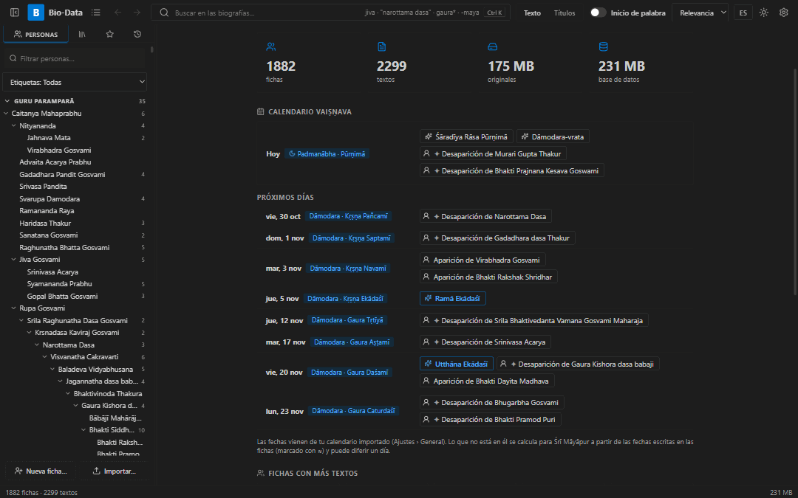

# Gaudiya Vaisnavas DB

*(antes «Bio-Data»)*

Aplicación de escritorio para Windows con **biografías vaiṣṇavas**: fichas de cada santo,
sus textos y búsqueda instantánea. Hermana de [GaudiyaDB](https://github.com/yogeshdasa-droid/GaudiyaDB).

A diferencia de GaudiyaDB, Gaudiya Vaisnavas DB es **autosuficiente**: al importar, el texto, las portadas
y los PDF / Word originales se copian **dentro de la base de datos**. Después las carpetas de
origen ya no hacen falta, y todo se edita desde la app.



## Qué hace

- **Fichas de personas**: nombre, otros nombres, aparición, desaparición, lugar, guru,
  discípulos, obras y notas. Cada ficha reúne todos los textos sobre esa persona
  (p. ej. la nota de Obsidian y los volúmenes de Calibre de *Jiva Gosvami* en una sola ficha).
- **Unir fichas** cuando dos nombres son la misma persona; la app sugiere nombres parecidos.
- **Importar** carpetas o archivos `.md`, `.txt`, `.pdf`, `.docx`, `.doc` (Word / WordPerfect
  antiguos) y `.html`. Reconoce bibliotecas de Calibre (PDF + portada + `metadata.opf`).
  Las copias idénticas se omiten; volver a importar solo añade lo nuevo.
- Convierte la fuente antigua **Balaram** (`Kåñëa`) a IAST (`Kṛṣṇa`).
- **Búsqueda** sin diacríticos y con variantes (`krishna` = `kṛṣṇa`), frases exactas,
  `palabra*`, `-excluir`, `OR`; filtros por colección, carpeta, texto o persona.
- **Lector** con resaltado, marcadores y visor del **PDF original** guardado. Estilo de lectura
  «Editor» (Markdown visible, como en VS Code), Literata o Inter.
- Los **nombres** de otras fichas que aparecen en un texto son enlaces a su ficha.
- **Imagen** propia para cada ficha; una ficha con un solo texto lo muestra directamente.
- **Atrás / Adelante** como en un navegador (`Alt+←/→`).
- **Edición** del texto y los datos; **papelera** con recuperación; **versiones anteriores**
  de cada texto y ficha para deshacer cambios.
- **Copias de seguridad automáticas** (todo está en un solo archivo) en *Documentos\Gaudiya Vaisnavas DB\Copias de seguridad*, y **restaurar** desde Ajustes.
- **Guru Paramparā** como árbol (arrastrar para ordenar, y dibujada) y **línea de tiempo**.
- **Calendario vaiṣṇava**: hoy y los próximos días con las apariciones y desapariciones de las
  fichas, Ekādaśī y festivales. Importa tu calendario Gauḍīya (`.ics`); lo que no está en él se
  calcula (tithi al amanecer en Śrī Māyāpur).
- **Etiquetas**, **galería de imágenes**, ayudante para **unir fichas repetidas**.
- **Exportar** todo a Markdown (para Obsidian) o una ficha con sus textos; imprimir una ficha.
- Avisa cuando hay una **versión nueva**.
- Español / inglés, tema claro / oscuro.

## Descargar

Instalador para Windows en [Releases](https://github.com/yogeshdasa-droid/Gaudiya-Vaisnavas-DB/releases).

## Desarrollo

Requiere Node.js y Rust.

```powershell
npm install
npm run app:dev     # modo desarrollo
npx tsc --noEmit    # comprobar tipos
cd src-tauri; cargo test
npm run app:build   # instalador en src-tauri/target/release/bundle/
```

La base de datos está en `%APPDATA%\com.whispers.biodata\biodata.db`.

Para continuar el desarrollo (estructura, reglas, pendientes): **[DESARROLLO.md](DESARROLLO.md)**.

Hecho con Tauri 2, Rust (SQLite FTS5) y React.
